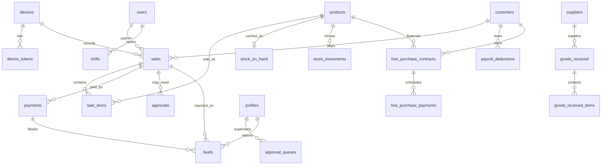

# DATABASE — Database Design

PostgreSQL 18 (Supabase). Canonical DDL: `server/src/main/resources/db/schema.sql`
(recorded as migration `0000 baseline_schema`). Admin extensions live in
`supabase/migrations/0001`–`0009`. The till uses a parallel SQLite dialect in
`src/db/schema.ts`; the two are kept field-identical by `tests/schema.test.ts`.

Verified fingerprint after 0009 (measured on two projects): **30 tables, 6 views,
20 policies, 12 functions, 5 triggers, 60 foreign keys, 111 CHECK constraints,
68 UNIQUE constraints, 0 sequences, 0 tables without a primary key.**

## 1. Table structures

### Canonical POS (21)

| Table | Key | Purpose |
| --- | --- | --- |
| `devices` | `device_id` text | Registered tills, store scope, token expiry |
| `device_tokens` | `token_hash` | Hashed bearer tokens (never the raw token) |
| `users` | `user_id` text | Cashiers/managers/admins, PIN + password **hashes** only |
| `suppliers` | `supplier_id` | Purchase counterparties |
| `products` | `product_id` | Catalog: price, cost, `tax_rate_bp`, low-stock threshold, media |
| `goods_received` / `goods_received_items` | `grn_id`, `item_id` | Receiving headers/lines |
| `shifts` | `shift_id` | Cash float, expected vs counted, variance |
| `sales` | `sale_id` | Receipt number, totals, kind (`sale/void/refund`), sync state |
| `sale_items` | `item_id` | Line: qty, unit price, discount, tax, `price_source` |
| `payments` | `payment_id` | Method, amount, status, provider ref, `blocked` (0009) |
| `stock_movements` | `movement_id` | Append-only ledger with reason codes |
| `stock_on_hand` | `product_id` | Materialised cache, rebuildable from movements |
| `receipt_counters` | (`device_id`,`day`) | Gapless per-device receipt numbers |
| `outbox` | `event_id` | Pending events, idempotency key, attempts |
| `processed_events` | `event_id` | Applied events with result payload |
| `approvals` | `approval_id` | Requester, approver, action, entity, reason |
| `audit_log` | `audit_id` | Hash-chained (`prev_hash`, `hash`), append-only |
| `device_sync_state` | `device_id` | Contiguous ack watermark, last hash |
| `pending_events` | (`device_id`,`seq`) | Buffered gap events |
| `rejected_events` | (`device_id`,`seq`) | Permanently invalid payloads |

### Admin extensions (9)

| Table | Key | Purpose |
| --- | --- | --- |
| `profiles` | `id` → `auth.users` | Role, `is_active`, `mfa_required`, `is_supervisor` |
| `product_categories` | `product_id` | One category per product |
| `product_price_audit` | `audit_id` | Old/new price, changed_by, reason |
| `customers` | `customer_id` uuid | Staff number, company, phone, payment preference |
| `payroll_deductions` | `deduction_id` | Amount, month (`YYYY-MM`), status |
| `hire_purchase_contracts` | `contract_id` | Product, duration, deposit, installment, balance |
| `hire_purchase_payments` | `hp_payment_id` | Installment schedule (due/paid/overdue/waived) |
| `approval_queues` | `queue_id` | Supervisor queue for escalated faults |
| `faults` | `fault_id` text | Sale/payment fault with lifecycle + `payment_blocked` |

## 2. Relationships (ER, core)

## 3. Data types and money rules

- Money and quantities: `BIGINT` (pesewas / units). No `NUMERIC`, no floats.
- Tax: `tax_rate_bp` basis points (1250 = 12.5%).
- Time: `TIMESTAMPTZ` (the dashboard groups by UTC date).
- Identity: canonical tables use text ids supplied by the device (UUID strings);
  admin tables use `uuid` with `gen_random_uuid()`.
- Flexibility: sync payloads in JSONB (`outbox.payload`, `processed_events.payload`,
  `rejected_events.payload`, `audit_log.details`).

## 4. Indexing strategy

- Primary keys on every table (verified: 0 tables without a PK).
- Hot paths: `sales(device_id, created_at)`, `sale_items(sale_id)`,
  `payments(sale_id)`, `payments(status)`, `stock_movements(product_id, occurred_at)`,
  `outbox(status, device_id, seq)`, `audit_log(device_id, seq)`,
  `device_tokens(device_id)`.
- Admin: partial index on pending approval-queue rows; indexes on
  `faults(sale_id)`, `faults(payment_id)`, `faults(status)`.
- Unique constraints double as indexes: `sales(device_id, receipt_number)`,
  `outbox(device_id, seq)`, `payments.idempotency_key`, `customers.staff_number`,
  `audit_log(device_id, seq)`, event/seq pairs on the sync tables.

## 5. Migrations

| File | Contents | Rollback |
| --- | --- | --- |
| `0000` (runtime) | Canonical schema from `schema.sql` | n/a (recreate) |
| `0001_admin_foundation` | profiles, `is_admin()`, 9 policies, 2 dashboard views | yes |
| `0002_product_management` | categories, price audit, 2 admin RPCs, catalog view | yes |
| `0003_dashboard_aggregation_and_authz` | fixed daily roll-up view, authz | yes |
| `0004_rpc_search_path_hardening` | `search_path = ""` on the RPCs | yes |
| `0005_customers_payroll_hirepurchase` | customers, payroll, hire purchase, MoMo channels, 2 views | yes |
| `0006_phase43_workflows` | inventory view, RPCs for contracts/installments/media, dashboard view refresh | **no** |
| `0007_mobile_money_reconciliation` | reconcile RPC, payments constraints | **no** |
| `0008_authorize_admin_policies` | retargets 15 admin policies to `authenticated` | yes |
| `0009_phase47_faults` | faults, approval_queues, supervisor role, block triggers | yes |

Rules: apply in filename order, one transaction per file, record history after
each. `supabase db query --file` is the sanctioned path; the JDBC tools in
`server/tools` enforce the same discipline (read-only probe, transaction-scoped
apply). The 0006/0007 rollback gap is tracked in `docs/production-readiness.md`.

## 6. Seed data

- Tests build their own data: `seedServer()` (Kotlin), `tests/helpers.ts` (Vitest),
  and the E2E script seeds auth users, profiles, a cashier, a sale and a payment
  through the service role, then deletes them.
- `scripts/demo.ts` walks the till domain end to end.
- The admin app has no fixtures; it reads whatever the project contains.

## 7. Data integrity (verified 2026-11-01)

| Check | Result |
| --- | --- |
| Unvalidated foreign keys | 0 of 60 |
| Tables without a primary key | 0 |
| Orphan `profiles` (no `auth.users`) | 0 |
| Orphan `sales.cashier_id` | 0 |
| Orphan `payments.sale_id` | 0 |
| MD5 checksums, live vs backup (customers, sales, profiles, payments) | match |
| Sequences | 0 — all keys are client-supplied text or `gen_random_uuid()` |
| RLS enabled | on every client-reachable table |
| `search_path` pinned | 12/12 public functions |

The dev project was rebuilt from these migrations with its data preserved; the
**same row counts and checksums** were reproduced afterwards.

## 8. Performance considerations

- Checkout is local (SQLite) and the server only sees batched events, so the
  critical path has no network round trip.
- `stock_on_hand` is a cache; the movement ledger is the source of truth and can
  rebuild it, so a bad cache is recoverable without data loss.
- Sync pulls use per-source cursors (`since={deviceId: seq}`) and a bounded
  `limit` (≤1000), preventing full-table scans on catch-up.
- The dashboard view aggregates once per day instead of per line item
  (regression-tested by `AdminMigrationTest`).
- Known gaps: no partitioning or archival for `audit_log`/`stock_movements`, no
  connection-pool tuning for production, no query plan review under load.
